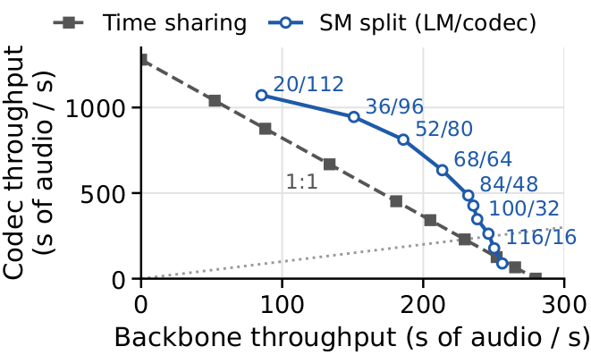
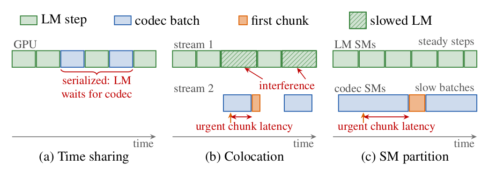
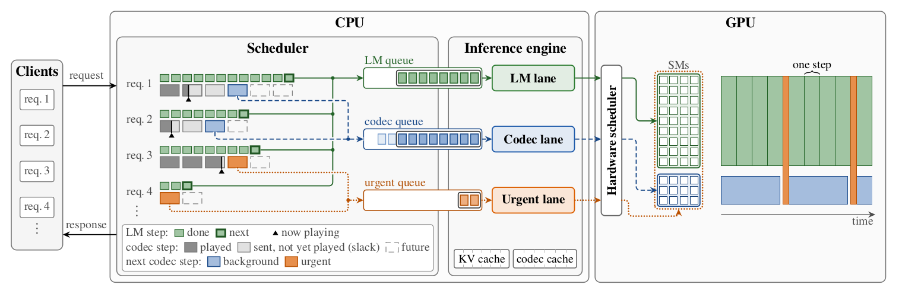
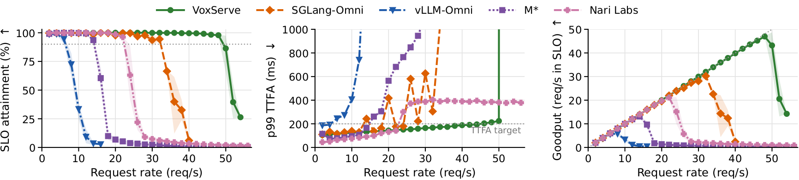

**TL;DR:** We are releasing **VoxServe v2**, a major update of our serving system for speech language models (SpeechLMs). Its serving loop now runs in a native Rust runtime, and it splits the GPU spatially by the *urgency* of audio work: the LLM backbone and the audio codec run side by side on separate partitions of the GPU, and only the chunks a listener is waiting for, a request's first chunk and chunks close to their playback deadline, get the whole GPU. On Qwen3-TTS on one H100, VoxServe v2 serves **48 requests/s** with time-to-first-audio (TTFA) under 200 ms and no playback stalls for at least 90% of requests, **1.5×** the best existing system we measured. The design and the full evaluation are in the new version of our [paper](https://arxiv.org/abs/2602.00269).

Code: [https://github.com/vox-serve/vox-serve](https://github.com/vox-serve/vox-serve)

---

## What's new in v2

- **A native Rust runtime.** HTTP serving, scheduling, KV-cache paging, attention planning and CUDA graph launches run in Rust, with no Python on the per-step path. Host-side scheduling takes less than 0.1 ms (median) between engine steps.
- **Spatial GPU splitting by urgency.** Three asynchronous lanes on partitions of the GPU's streaming multiprocessors (SMs), a full-GPU lane for urgent chunks, codec batching within each chunk's slack, and deadline-aware admission of new requests. The rest of this post explains how they work.
- **Models written once.** Each model is a single Python program that declares its stages, buffers and per-request codec state. VoxServe captures the stages as CUDA graphs at startup and drives them from the Rust runtime. The same program also runs on VoxServe's Python runtime, which stays available (`--runtime python`) and takes over automatically when the Rust runtime is unavailable.
- **New models.** [CosyVoice 3](https://huggingface.co/FunAudioLLM/Fun-CosyVoice3-0.5B-2512), [Higgs Audio v3](https://huggingface.co/bosonai/higgs-tts-3-4b) and [Voxtral TTS](https://huggingface.co/mistralai/Voxtral-4B-TTS-2603) join Qwen3-TTS, Orpheus, CSM, Zonos, Chatterbox, CosyVoice 2, GLM-4-Voice and Step-Audio 2 ([full list](https://vox-serve.github.io/vox-serve/models.html)).
- **Fused kernels and multi-GPU serving.** Optional fused kernels for backbones and codecs (`--fuse-*`), and serving on several GPUs with replicas or a shared codec GPU.

## Streaming speech is judged differently

A SpeechLM pairs an autoregressive **LLM backbone**, which emits one audio token per request per step, with a **codec** that turns each completed chunk of tokens into a waveform (see our [first post](/2025/09/29/introducing-vox-serve.html) for background). In streaming, a listener judges two things: how soon audio starts (**TTFA**), and whether it then plays without interruption, which requires every chunk to arrive before the audio already delivered runs out (**streaming viability**). We count a request as meeting the service-level objective (SLO) when its TTFA is at most 200 ms and its playback never stalls, and a system's **SLO capacity** is the highest request rate at which at least 90% (or 99%) of requests meet it.

This makes the chunks of a request unequal. The first chunk sits on the TTFA critical path. A later chunk is only needed once the audio before it has finished playing, so it has *slack*: time it can wait without anyone noticing. A Qwen3-TTS request in our LibriTTS workload has 10.2 chunks on average, so about 90% of chunks can have slack.

## The opportunity: split the GPU, except for urgent work

Modern speech models are small next to the GPUs they run on. The backbone of Qwen3-TTS has 1.7B parameters, and on 108 of an H100's 132 SMs it keeps 93–99% of its full-GPU speed. So the codec can run on the SMs the backbone leaves idle. The figure below measures the throughput of both components running back-to-back. Time-sharing the GPU between them gives the dashed line, and almost every split of the SMs between the backbone and the codec lands above it.

<p align="center">

<br>
Backbone and codec throughput of Qwen3-TTS on one H100, time-shared or on SM splits (labels: LM/codec SMs). Below the dotted line, the codec falls behind the backbone.
</p>

The catch is codec latency. With 24 SMs beside the backbone, a batch of 16 chunks takes 49 ms instead of 10 ms on the whole GPU, and a single chunk takes 5.0 ms instead of 1.9 ms. Chunks with slack can absorb that; a first chunk cannot. None of the usual ways to share a GPU handles both kinds of chunk well:

<p align="center">

<br>
Three ways to place the backbone (LM) and the codec on one GPU. Time sharing serializes them; colocation lets a codec batch slow the LM; a fixed SM partition makes urgent chunks wait behind slow codec batches.
</p>

## How VoxServe v2 works: three lanes

<p align="center">

<br>
VoxServe v2 on one GPU. The scheduler forms an LM batch every iteration and routes each request's next chunk by urgency: first chunks and chunks with little slack to the urgent lane on all SMs, the rest to background codec batches.
</p>

On each GPU, a scheduler thread in the Rust runtime drives three asynchronous lanes, each an in-order execution queue:

- The **LM lane** runs backbone steps with continuous batching (prefill and decode, including any depth transformer and token sampling) on a large partition of the SMs.
- The **background codec lane** runs batches of continuation chunks on a small partition beside it. A batch launches once enough chunks are ready (8 for Qwen3-TTS), or earlier when the earliest playback deadline approaches or the backbone has nothing left to generate.
- The **urgent lane** runs first chunks, and chunks whose deadline is less than 100 ms away, on the whole GPU at high priority. It has its own buffers and codec state, so it never waits for a background batch.

The scheduler refills each lane as soon as its previous batch finishes. The backbone therefore keeps stepping while a background batch spans several of its steps, and an urgent chunk never queues behind either. Codecs that carry state from one chunk to the next keep each request's state in a device-side slot, so requests can share a batch on either lane.

The LM side has one more lever. A prefill runs on the whole GPU and delays the next step of every running request. VoxServe estimates how much slack each running request's next chunk has, and briefly defers a new request's prefill (at most 100 ms) when admitting it would make a running request miss its playback deadline.

The SM split is chosen offline by profiling, as in the throughput figure above. At startup, VoxServe captures every per-step stage as a CUDA graph for each batch size and for both the split and the whole GPU (SM partitions use NVIDIA green contexts), so moving work between partitions at runtime is just a matter of launching a different graph.

## Results

We serve Qwen3-TTS on one H100 with requests from the LibriTTS test-clean split, sent with Poisson arrivals, and compare against [vLLM-Omni](https://github.com/vllm-project/vllm-omni), [SGLang-Omni](https://github.com/sgl-project/sglang-omni), [M*](https://arxiv.org/abs/2606.12688) and the [Nari Labs Qwen3-TTS engine](https://narilabs.com/blog/qwen3-tts-speed-cost-frontier/). VoxServe holds the SLO for 90% of requests up to **48 req/s**, 1.5× the 32 req/s of the best baseline, SGLang-Omni. At 99% attainment it serves **44 req/s**, against 18 for the best baseline there, Nari Labs' engine.

<p align="center">

<br>
Qwen3-TTS on one H100 with the LibriTTS workload. Left: share of requests with TTFA ≤ 200 ms and no stall (dotted line at 90%). Middle: p99 TTFA. Right: goodput, the requests per second that meet the SLO.
</p>

The [paper](https://arxiv.org/abs/2602.00269) has the rest of the evaluation:

- **Other models:** CosyVoice 3, whose flow-matching codec dominates its GPU time, and Higgs Audio v3, whose 4B backbone does.
- **Multiple GPUs:** serving on two and four H100s.
- **Another workload:** the shorter Seed-TTS sentences of Nari Labs' benchmark.
- **Another GPU:** B200.
- **Ablation:** VoxServe's mechanisms added one at a time to a synchronous, time-shared loop, plus the sensitivity to the SM split and how the admission policy behaves past capacity.

## Try it

Install VoxServe from PyPI:

```bash
pip install vox-serve
```

Serve Qwen3-TTS with the configuration from the paper (100/32 SM split, urgent lane, deadline-aware scheduling, fused kernels):

```bash
vox-serve --model qwen3-tts --port 8000 --max-batch-size 64 \
  --sm-modes 32 --sm-mode 1 --dec-batch 8 --stream-priorities \
  --urgent-lane --scheduler-type deadline \
  --fuse-depth --fuse-talker --compile-detok
```

and stream speech from it:

```bash
curl -X POST "http://localhost:8000/generate" \
  -F "text=Hello from VoxServe v2." -F "streaming=true" -o output.wav
```

The [documentation](https://vox-serve.github.io/vox-serve/) explains the [two runtimes and their options](https://vox-serve.github.io/vox-serve/runtimes.html), and [how to add a model](https://vox-serve.github.io/vox-serve/adding-a-model.html): one Python program per model, used by both runtimes. The load benchmark we used is [`benchmark/goodput.py`](https://github.com/vox-serve/vox-serve/blob/main/benchmark/goodput.py).

VoxServe is open source on [GitHub](https://github.com/vox-serve/vox-serve). Read the [paper](https://arxiv.org/abs/2602.00269) for the details, and let us know what you build with it!
